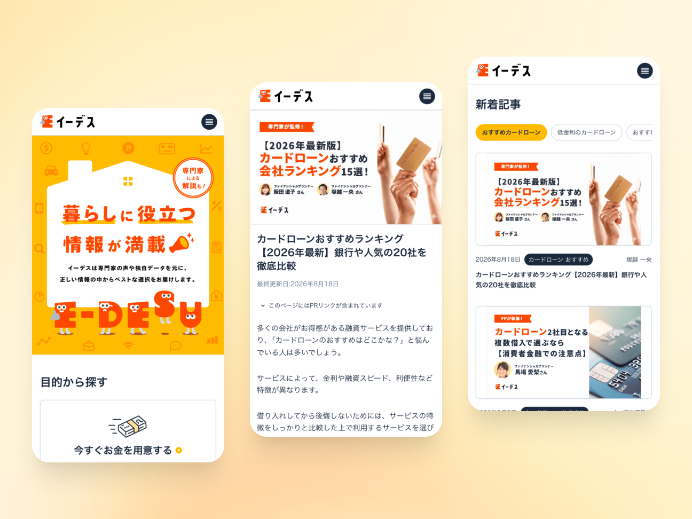

## 概要

〔仮〕複数のライフスタイルメディアをひとつのドメインに統合し、新ブランドとして立ち上げたプロジェクト。

## 課題

〔仮〕個別に運営されていたメディアをまとめつつ、既存の集客と売上を維持する必要があった。

## プロセス

〔仮〕事業責任者、エンジニア、デザイナーと進行。調査、設計、実装で判断したことを記入。

## 成果

〔仮〕数値と測定条件を記入。

## 学び

〔仮〕次に活かしている学びを記入。
