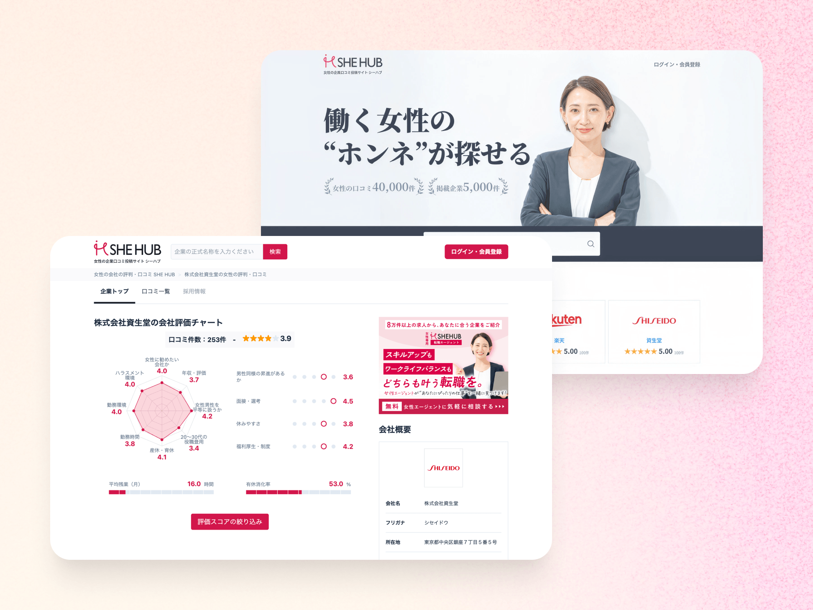

## 概要

〔仮〕働く女性が、女性目線の口コミを基に転職先を探せるサイト。

## 課題

〔仮〕一般的な転職サイトでは見えにくい、女性の働きやすさに関する情報をどう信頼できる形で届けるかが課題だった。

## プロセス

〔仮〕調査で分かったこと、設計で判断したこと、実装で工夫したことを記入。

## 成果

〔仮〕数値と測定条件を記入。

## 学び

〔仮〕次に活かしている学びを記入。
